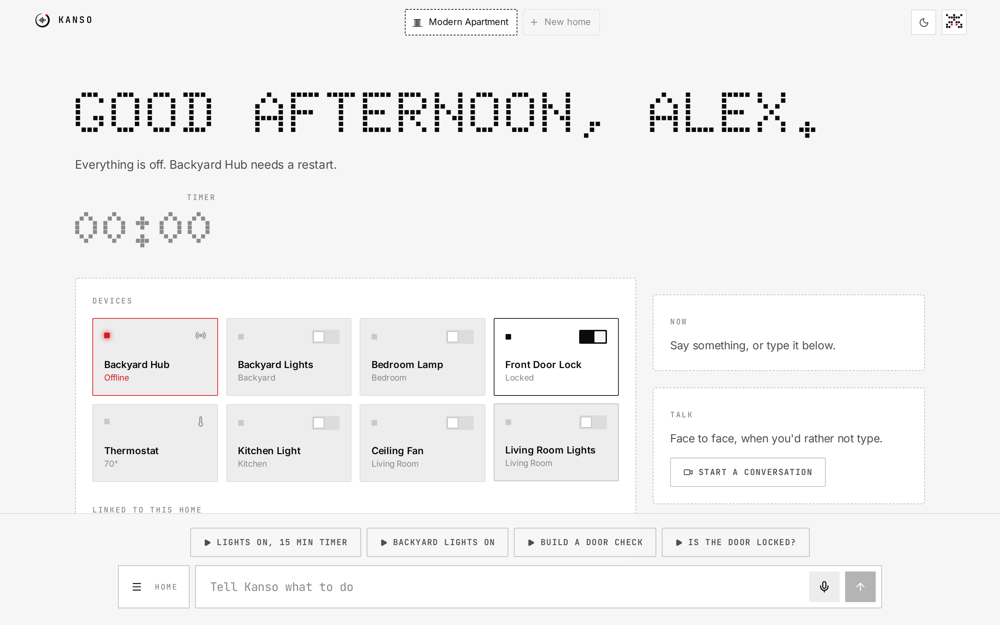

# Kanso

Local AI for fast, private voice control.

Kanso is a self-hosted [Model Context Protocol](https://modelcontextprotocol.io) server for Alexa+ and the Tavus Conversational Video Interface. Speech recognition, PII redaction and intent routing run on your own machine with Desert Ant Labs models, so a command round-trips in well under 200 ms and nothing personal leaves the house. Describe an automation out loud and AWS Bedrock writes the tool, which Kanso validates and hot-loads without a restart.



## What it does

| Flow | What happens | Screenshot |
| --- | --- | --- |
| Onboarding | A name and a first home. No account. | [01](screenshots/01-onboarding.png) |
| Voice command | "Turn on the living room lights and set a timer for 15 minutes" runs locally and the UI updates over server-sent events. | [03](screenshots/03-lights-and-timer.png) |
| Visual troubleshooting | The backyard hub times out, so a card with a restart button appears instead of a verbal apology. After the restart the blocked command is replayed. | [04](screenshots/04-hub-offline.png), [05](screenshots/05-hub-restarting.png), [06](screenshots/06-hub-back.png) |
| Clarification | "Turn on the kitchen fan" gets a binary question, not a hallucination. | [07](screenshots/07-clarifying-question.png) |
| Voice-to-tool | "Create a tool that checks my front door lock..." generates a TypeScript MCP tool and hot-loads it. The code stays out of the way until you ask for it. | [08](screenshots/08-automation-built.png), [12](screenshots/12-automations.png) |
| Homes and devices | Add as many homes as you like, each with a generated icon (or your own SVG), and link Echo and hub devices to each. | [09](screenshots/09-new-home.png), [10](screenshots/10-link-device.png), [11](screenshots/11-second-home.png) |
| Privacy | Every request with what was hidden, plus the counts that are the only thing sent anywhere. | [13](screenshots/13-privacy.png) |

A two and a half minute walkthrough of these flows is in [docs/demo/kanso-demo.mp4](docs/demo/kanso-demo.mp4).

Every screen is captured in light mode, dark mode (`*-dark.png`) and at phone width (`*-phone.png`). The design system is documented in [docs/DESIGN.md](docs/DESIGN.md).

## Stack

- `apps/backend`: NestJS 11 on Node 25, built with SWC. MongoDB through Mongoose (an in-memory MongoDB starts automatically when `MONGODB_URI` is unset). `@modelcontextprotocol/sdk` over Streamable HTTP at `/mcp`. `@desert-ant-labs/voz`, `redact` and `gist` for on-device speech, PII and topics. `@aws-sdk/client-bedrock-runtime` for code generation. `chokidar` and `zod` for the hot-reload extension loader. OAuth 2.1 with PKCE for Alexa+ account linking.
- `apps/frontend`: Vite, React 19, Tailwind 4, Zustand, installable as a PWA. `@tavus/cvi-ui` components for the PAL video and Magic Canvas. The API client is generated by orval from the backend's OpenAPI document. Formatting and linting with oxfmt and oxlint (type-aware through tsgolint).
- `extensions/`: user-generated tools, watched and hot-reloaded. `_kanso.ts` gives every tool a typed `ctx` through `defineTool`, with devices as a discriminated union so a lock has `locked` and a light has `isOn`.

The backend is a modular monolith. `src/platform` holds the shared kernel (config, the tool registry, domain events). Each feature module (`home`, `commands`, `tools`, `codegen`, `local-ai`, `realtime`, `oauth`, `mcp`, `tavus`) exposes a public `index.ts` and talks to the others through those exports or the `@nestjs/event-emitter` bus, never through internals.

## Run it with Docker

The quickest way to try Kanso. One container serves the web app, the API and the MCP endpoint on port 3000, with a built-in database and no keys needed.

```bash
docker build -t kanso .
docker run --name kanso -p 3000:3000 -v kanso-models:/root/.cache/desert-ant-models -v kanso-data:/data/kanso kanso
```

Open http://localhost:3000 and choose Try the demo. The on-device models (about 500 MB) download on first start, which takes a few minutes; commands work straight away with a pattern fallback until they finish. The two volumes keep the models and your homes for next time, so `docker start kanso` picks up where you left off.

Everything except the video assistant works without any accounts. To talk to Kanso face to face, follow [Turn on the video assistant](#turn-on-the-video-assistant). To have AWS Bedrock write automations instead of the local generator, add `-e AWS_REGION=... -e AWS_ACCESS_KEY_ID=... -e AWS_SECRET_ACCESS_KEY=...` to `docker run`.

## Turn on the video assistant

The video assistant is a Tavus PAL that controls your home through Kanso's MCP tools. It needs three things: a Tavus API key, a public https address for Kanso so Tavus can reach its tools, and a one-time setup that registers Kanso with Tavus.

### 1. Get a Tavus API key

1. Sign up or sign in at the [Tavus PAL Maker](https://maker.tavus.io/dev).
2. Choose **API Key** in the sidebar, then **Create New Key**.
3. Give it a name, leave the IP list empty, and choose **Create API Key**.
4. Copy the key straight away. Tavus can't show it again, so if you lose it, create a new one.

Keep the key to yourself. Never commit it or paste it into the web app; Kanso only reads it from the environment.

### 2. Install Cloudflare Tunnel

`cloudflared` gives the Kanso running on your computer a temporary public https address. Quick tunnels need no Cloudflare account.

- macOS: `brew install cloudflared`
- Windows: `winget install --id Cloudflare.cloudflared`
- Debian or Ubuntu:
  ```bash
  curl -L -o cloudflared.deb https://github.com/cloudflare/cloudflared/releases/latest/download/cloudflared-linux-amd64.deb
  sudo dpkg -i cloudflared.deb
  ```
- Fedora or RHEL:
  ```bash
  sudo dnf install https://github.com/cloudflare/cloudflared/releases/latest/download/cloudflared-linux-x86_64.rpm
  ```
- Any other system: download the binary for your platform from the [cloudflared releases](https://github.com/cloudflare/cloudflared/releases/latest).

Check it works with `cloudflared --version`.

### 3. Open the tunnel

In its own terminal, leave this running:

```bash
cloudflared tunnel --url http://localhost:3000
```

It prints an address like `https://some-random-words.trycloudflare.com`. That is your public URL. Only `/mcp` and sign-in pages are useful through it: the web app's API refuses anything that doesn't come from your computer or home network, and every tool call needs a link approved by you.

### 4. Set up Tavus

With Docker, start Kanso with your key and the tunnel address. If a `kanso` container already exists, remove it first with `docker rm -f kanso`; your homes are kept in the `kanso-data` volume.

```bash
docker run -d --name kanso -p 3000:3000 \
  -v kanso-models:/root/.cache/desert-ant-models -v kanso-data:/data/kanso \
  -e TAVUS_API_KEY=your-key -e PUBLIC_URL=https://some-random-words.trycloudflare.com \
  kanso
```

Open http://localhost:3000 and finish the short setup so you have a home. Then run the Tavus setup inside the container:

```bash
docker exec kanso node apps/backend/scripts/tavus-setup.ts
```

It creates the Kanso PAL, registers Kanso as its MCP connector, attaches Magic Canvas, and prints three things:

- `TAVUS_PAL_ID` and `TAVUS_CONNECTOR_ID`. Note them down.
- A link. Open it, and when Kanso asks for a link code, get one from **Link a device**, then **Show link code**, in the web app. Codes work once and expire after 10 minutes.

Finally, restart Kanso with the two IDs added so the web app can start calls:

```bash
docker rm -f kanso
docker run -d --name kanso -p 3000:3000 \
  -v kanso-models:/root/.cache/desert-ant-models -v kanso-data:/data/kanso \
  -e TAVUS_API_KEY=your-key -e PUBLIC_URL=https://some-random-words.trycloudflare.com \
  -e TAVUS_PAL_ID=the-pal-id -e TAVUS_CONNECTOR_ID=the-connector-id \
  kanso
```

Open http://localhost:3000, choose **Start a conversation** on the home screen and allow the camera and microphone. Ask it to turn on a light and watch the tile change.

Without Docker, put the same values in `apps/backend/.env` (`TAVUS_API_KEY` and `PUBLIC_URL` first), start Kanso with `pnpm dev`, run `pnpm tavus:setup`, open the link it prints, add `TAVUS_PAL_ID` and `TAVUS_CONNECTOR_ID` to `.env`, and restart `pnpm dev`.

### When the tunnel address changes

A quick tunnel gets a new address every time `cloudflared` restarts. When that happens, start Kanso with the new `PUBLIC_URL` and the IDs you already have, then run the setup again. With `TAVUS_CONNECTOR_ID` set it repoints the existing connector instead of creating another one, and prints a fresh link to approve with a new link code. For an address that never changes, run Kanso on a host such as Railway (see [Deploy](#deploy)) or set up a named Cloudflare tunnel.

Calls use your Tavus account's conversation minutes, so end them with the button on the call when you're done.

## Run it for development

Requires Node 25 and pnpm 12 (see `.tool-versions`).

```bash
pnpm install
cp apps/backend/.env.example apps/backend/.env
cp apps/frontend/.env.example apps/frontend/.env
pnpm dev
```

Open https://localhost:5173. The API docs are at http://localhost:3000/api/docs. If your browser won't accept the self-signed certificate, run `KANSO_HTTP=1 pnpm dev` and open http://localhost:5173 instead; this only works on this computer.

The Desert Ant models download from Hugging Face on first start and are cached under `~/.cache`. Until they are ready, redaction uses a pattern fallback and voice input uses the browser's speech recognizer; the status chips at the top of the dashboard show which models are loaded. Set `LOCAL_AI=off` to skip the models entirely.

### Test the MCP endpoint

```bash
curl -X POST http://localhost:3000/mcp \
  -H "Content-Type: application/json" \
  -H "Accept: application/json, text/event-stream" \
  -d '{"jsonrpc":"2.0","id":1,"method":"tools/list"}'
```

### Link Alexa+

Alexa+ links to Kanso, not the other way round. Point the Alexa+ add-on at `<PUBLIC_URL>/mcp`; account linking uses Kanso's OAuth 2.1 server (`/.well-known/oauth-authorization-server`, PKCE S256, dynamic client registration). Once linked, Alexa+ sees your homes and devices through the MCP tools, including `list_homes` and `switch_home`. With `MCP_AUTH=required`, only linked clients can call tools. When an app asks to link, Kanso's consent page asks for a six-digit link code. Get it from Link a device in the web app on the computer running Kanso; the code is never shown through the public URL, works once, and expires after 10 minutes. Linked apps and their tokens are stored in MongoDB, so they survive restarts.

### Use the microphone and camera on other devices

The dev server uses https with a self-signed certificate by default, because browsers only allow the microphone and camera on secure pages. Open `https://<this computer's IP>:5173` on your phone over the same wifi and accept the browser's warning once. The dev server proxies `/api` to the backend, so nothing else needs to be exposed. For the video assistant, see [Turn on the video assistant](#turn-on-the-video-assistant).

### Enable Bedrock code generation

Set `AWS_REGION`, `AWS_ACCESS_KEY_ID`, `AWS_SECRET_ACCESS_KEY` and optionally `BEDROCK_MODEL_ID`. Without them a local template generator produces a working tool so the demo still runs.

### Format and lint

```bash
pnpm --filter @kanso/frontend fmt        # oxfmt
pnpm --filter @kanso/frontend fmt:check
pnpm --filter @kanso/frontend lint       # oxlint with type-aware rules
```

### Regenerate the API client

```bash
pnpm --filter @kanso/backend gen:openapi   # writes apps/backend/contracts/openapi.json
pnpm --filter @kanso/frontend gen:api-hooks  # runs orval into apps/frontend/src/api/generated
```

## Deploy

- Backend on Railway: root directory `apps/backend`, build `pnpm install && pnpm build`, start `node dist/main`, env from `.env.example` plus `MONGODB_URI`, and `APP_ACCESS=public` so the hosted frontend can reach `/api`. That API has no sign-in, so put the deployment behind your own access control.
- Frontend on Vercel: root directory `apps/frontend`, env `VITE_BACKEND_URL` set to the Railway URL.
- Re-run `pnpm tavus:setup` with `PUBLIC_URL` set to the Railway URL so the connector points at production.

## License

MIT
